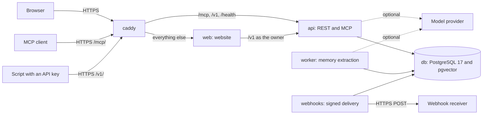

# Architecture

This page describes how the self-hosted edition is built: its processes, the code layout, access control, storage, the write path, search and recall, and background work. [Self-hosting](SELF_HOSTING.md) covers installing and running it, and [Database](DATABASE.md) lists the roles, tables and maintenance commands.

## Processes

One Docker Compose stack (`compose.yaml`) runs everything on one machine. Only Caddy publishes ports.



| Service | What it runs | Database login |
|---|---|---|
| `db` | PostgreSQL 17 with pgvector (`pgvector/pgvector:0.8.2-pg17`). All data lives in the `db-data` volume. | |
| `migrate` | `python -m space.install`, then exits. It creates the restricted logins `space_app`, `space_worker` and `space_webhook` with the passwords from `.env`, or resets existing logins to those passwords, applies the Alembic migrations through `0038_export_snapshots`, sizes the empty memory index to `SPACE_MEMORY_EMBEDDING_DIMENSIONS`, and logs in as each login to verify it. It runs on every `docker compose up`. | `postgres`, the superuser |
| `api` | The FastAPI application in one Uvicorn process: the REST API under `/v1`, the MCP endpoint at `/mcp/`, and `/health/live` and `/health/ready`. At startup it creates the owner's Private Space if it does not exist yet. | `space_app` |
| `worker` | `python -m space.job_worker`, which runs memory extraction jobs. While the queue is empty it runs one cheap query every 3 seconds; each job attempt runs in a fresh child process. | `space_worker` for the queue, `space_app` for content |
| `webhooks` | `python -m space.webhook_worker --loop`, which delivers signed webhooks with the same idle check. | `space_webhook` for the queue, `space_app` for content |
| `web` | The website, a TanStack Start application on Node.js. It holds no database credentials and reaches the data only through the REST API. | none |
| `caddy` | Caddy 2. It serves HTTPS with automatic certificates, or plain HTTP on a private network, and sends `/mcp`, `/v1/*`, `/health/*`, the OAuth endpoints under `/oauth/` and their `/.well-known/` metadata to the API, and everything else to the website (`deploy/Caddyfile`). | none |

The API, both workers and the installer are one Python codebase built into one image (`backend/Dockerfile`). REST and MCP are two adapters over the same commands, so an agent and the website read and change the same records under the same revision checks.

## Code map

```text
backend/src/space/
  app.py                      Composition root: settings, database pool, credential verifier, REST and MCP
  settings.py                 Runtime settings (Settings), from the environment and backend/.env
  install.py                  The installer the migrate service runs
  database_setup.py           Installer settings (InstallSettings), the space schema and the space_app login
  worker_setup.py             The restricted queue logins of the two workers
  security/auth.py            Credentials to identities: the owner, an agent connection or an API key
  security/payloads.py        Stored payloads as canonical JSON, bounded to 1 MiB
  private_access.py           Per-agent connections in private mode
  device_auth.py              Agent tokens: the device-code flow and connections created on the website
  api_keys.py                 Personal API keys
  api/rest.py, api/mcp.py     The two transports; api/reference.py writes docs/openapi.json
  workspace.py                The shared command boundary: scope checks, revisions, saves and recall
  tasks.py                    The canonical Tasks collection and its columns
  workspace_items.py          Projects, folders, sections, categories and databases
  database_sql.py             SQL over one database's records
  workspace_search.py         Paged full-content search
  memory.py                   Memory request contracts, lexical ranking and output bounds
  memory_pipeline.py          Extraction with the vendored Memora runtime
  brain.py                    The pgvector claim index and its search SQL
  recall_candidates.py        Recall candidates: vector, keyword and linked claims, lexical sources
  relevance.py                Evidence assessment after retrieval; typesafe_relevance.py is the TypeSafe route
  memory_classification.py    Categories, sections and projects for each claim; catalog_shortlist.py for large catalogs
  memory_routing.py           Routing rules attached to containers; space_map.py builds the Space map
  memory_relationships.py     Inferred links between memories; memory_node_links.py and memory_link_index.py
  jobs.py, job_worker.py      The extraction queue and its worker supervisor; queue_watch.py is the idle check
  webhooks.py, webhook_*.py   Webhook subscriptions, the outbox, delivery and the worker
  workspace_archive.py        Space export; archive_schema.py and restore_*.py merge an archive back
  memora_*.py                 Importing Memora exports, from the website or import_memora.py
  overview.py                 The Overview page's activity log and totals
  teams.py                    Organizations, members and shared Spaces (hidden in the website)
  agents.py                   Agent identities
  quotas.py                   Usage counters
  model_provider.py           The bounded HTTP transport to the model provider and TypeSafe
  guide.py                    The operating guide served to agents
  retention.py, webhook_retention.py, purge.py
                              Operator maintenance commands
  _vendor/memora/             The vendored Microsoft Memora text runtime (MIT)
backend/migrations/           Alembic migrations 0001 to 0035, each applying its reviewed SQL file
backend/tests/                Unit tests, and database tests in disposable containers
apps/web/src/routes/          TanStack Start routes; api.$.ts forwards /api/* to the backend
apps/web/app/                 The website's components and styles; app/api/[...path]/route.ts is the proxy
apps/web/lib/                 Browser reads, the session and the backend transport
deploy/Caddyfile              The reverse proxy
scripts/                      setup.sh, backup.sh and restore.sh
skills/                       Optional agent skills
```

Smaller modules sit next to the ones they support. `workspace.py` is the only place that combines database scope, stored content and model access. `brain.py` owns the claim-index SQL but never calls a model, and `memory_pipeline.py` runs extraction but never touches the database.

## Identity and access

There are no user accounts. An installation has one implicit owner: every principal is recorded with the issuer `space`, and the owner's subject is a fixed UUID (`security/auth.py`), so the owner's data survives restarts, a new access key and a new domain. At startup the API creates the owner's personal organization, Private Space, Space key and canonical Tasks collection if they do not exist.

`SPACE_ACCESS_MODE` decides how requests are checked:

| | Key mode (default) | Private mode |
|---|---|---|
| Website | Asks for `SPACE_ACCESS_KEY` once per browser, then keeps a signed HttpOnly session cookie for 30 days. The website server calls the API with the access key; the browser never holds it. | Opens without any check. |
| REST API (`/v1`) | The access key as a bearer token acts as the owner. A personal API key acts as the owner within its one Space. | A request without credentials acts as the owner. A personal API key keeps its Space and read-only limits. |
| MCP (`/mcp/`) | Requires a Space-issued agent token or OAuth access token. The access key is refused. | Needs no token. Each agent identity gets its own connection, as described below. |

Agent tokens start with `spc_`. The owner creates one on the website under **Agents** (`POST /v1/agent-tokens`), or an agent asks for one through the device-code flow: it calls `POST /v1/device/code`, the owner approves the six-digit code on the website's `/connect` page, and the agent collects the token from `POST /v1/device/token`. A token lasts 180 days and is stored only as a SHA-256 digest. It stands for one connection grant, a row in `space.oauth_grants` (a historical table name), bound to the MCP address and either read-only or read-write. Revoking a connection disconnects only that agent.

Personal API keys start with `spk_` and are created under **Settings → API keys**. A key reaches the REST API only, for one Space, read-only or read-write, and cannot manage agents, keys, members, restores or webhooks. Keys expire after 90 days by default (at most 365, or never) and are stored as SHA-256 digests.

Every content request from an agent also names its agent identity, in the `X-Space-Agent-ID` header or the `agent_id` tool argument, and that identity must match the one bound to the connection. Before it identifies itself an agent can only discover the Space and call `identify_agent`. [Connecting agents](CONNECTING_AGENTS.md) has the details.

In private mode (`private_access.py`), MCP requests carry no credentials. Before identification every agent shares one unidentified connection that can only discover and identify. `identify_agent` then gives each agent identity its own read-write connection, with a client ID derived from the identity's ID, so attribution and the Agents page work as in key mode.

Apps that sign in through the browser, such as claude.ai, use the OAuth authorization server in `oauth_server.py`, served in key mode only. They discover it from the MCP endpoint's `401`, register themselves, and send the owner to the website's `/connect/authorize` page, which is behind the access key. Approval creates a connection grant for the registered client in the same transaction as a one-time code. The client exchanges the code and its PKCE verifier for an access token (`spo_`, one hour) and a rotating refresh token (`spr_`). Clients, requests and tokens live in `oauth_clients`, `oauth_requests` and `oauth_tokens`, with secrets as SHA-256 digests, and the runtime login reaches them only through definer functions. Each token is checked against its live grant, so revoking the connection stops it. Registration is open, as hosted apps require; a registration that never connects is removed after a day, and at most 1,000 are kept. The SDK's handlers in the `mcp` package implement the protocol; Space supplies the storage and the consent.

### Inside every command

Each transaction first sets the caller's issuer and subject as transaction-local settings. Row-level security policies on every Space-owned table compare rows with them and with the requested organization and Space. `Workspace._scope` then resolves the requested Space and checks, in order: the caller's role (a viewer cannot write), a read-only API key, the lease of a background job, and for an agent its live connection grant (not revoked, bound to this MCP address, read-write when writing) and its agent identity. A Space ID alone grants nothing.

The API connects as `space_app`, which does not own the schema and has no superuser, BYPASSRLS, role-creation or database-creation rights; the API refuses to start if its login is anything else. Migrations and maintenance commands use the separate superuser connection, which the API never receives.

### Organizations and shared Spaces

The backend also supports organizations, members, invitations and shared Spaces (`teams.py`, migration `0016_team_spaces`). An installation has one person, so there is nobody to invite, and the website hides these features. [Teams](TEAMS.md) describes what the backend does with them.

## Storage

Everything lives in PostgreSQL, in the `space` schema. There is no object storage, no key service and no application-level encryption.

- **Readable JSON.** Payloads such as document bodies, task fields, titles, database snapshots, memory records, agent profiles and Space settings are canonical UTF-8 JSON (sorted keys, compact separators) in `bytea` columns. The columns keep their historical `encrypted_*` names, for example `resource_revisions.encrypted_record` and `encrypted_metadata`; read one with `convert_from(encrypted_record, 'UTF8')::jsonb`. One payload is at most 1 MiB.
- **Inline bodies.** A document body is stored inline with its revision. The `object_key` column and the object-store interface in `providers.py` are unused; every write stores its body inline.
- **History.** Documents, tasks, memories, projects and databases keep every revision. An edit appends a new revision and moves the current-revision pointer.
- **Space keys.** Each Space has a random 32-byte key in `space_keys`, with the provider `local`. It encrypts nothing: it keys the search-term fingerprints in `resource_terms` and the request fingerprints that make retries safe. The key sits in the same database, so the fingerprints hide nothing from someone who can read it; they exist for lookup.
- **Claim index.** `memory_claims` holds one row per current memory claim: the embedding, SHA-256 hashes of the claim text and of its cue labels, the memory type, the declared importance, the embedding model, the source reference and identifiers. The claim text itself lives in the memory's revision. Every embedding has the same width: 1,536 dimensions unless `SPACE_MEMORY_EMBEDDING_DIMENSIONS` says otherwise (16 to 2000). The installer resizes the index while it is empty and refuses another width once embeddings are stored; the API and the worker read the width from the schema at startup.
- **Other derived tables.** `memory_links` and `memory_node_links` hold links between memories, `memory_routes` attaches routing rules to containers, `workspace_item_vectors` caches catalog embeddings for classification, and `activity_events` is the Overview's content-free activity log.
- **Usage counters.** Triggers count each Space's retained bytes, items and monthly model requests in `usage_limits`. Migration `0035_selfhosted_limits` sets every limit to its maximum value, which means no limit, and `GET /v1/spaces/{space_id}/usage` reports the limits as `null`.

## Write path

A document or task save (`Workspace._save`) runs these steps. Memory writes, workspace items and SQL on database records follow the same pattern.

1. Outside any transaction, Space checks the caller's scope, reads the Space key and looks up the command ID. It fingerprints the request with an HMAC under the Space key. A command ID already used with the same fingerprint returns the revision it saved; with a different fingerprint the request fails with 409.
2. Space prepares the JSON payloads and the term fingerprints. Memory writes call the model provider at this point, for embeddings and any classification. No network or model call runs inside a database transaction, because the restricted logins end a transaction that stays idle for 30 seconds.
3. One transaction rechecks the scope and the live grant, locks the Space row and compares the expected revision with the current one, failing with 409 on a mismatch. It appends the revision, moves the current-revision pointer, replaces the resource's term fingerprints, writes the command and event rows, records the Overview activity and, for a memory, updates the claim index, links and routes. A change to a database item also queues its webhook deliveries in the same transaction. Any failure rolls all of it back.
4. After the commit, Space rechecks live access before returning the saved revision.

Writes to one Space serialize briefly on the Space row. Retrying with the same command ID and payload is always safe, including after a timeout whose outcome is unknown.

## Search and recall

**Word search.** Every revision's title, topics and body are tokenized, and `resource_terms` stores keyed fingerprints of the current revision's terms with their counts. Lexical recall selects at most 256 candidates in SQL, then ranks them with BM25 over their metadata and up to 32 bodies. It needs no model. `search_workspace` and the website's search work differently: they scan the Space's current items 25 at a time for a plain text match, with a continuation cursor and a check that the Space did not change between pages.

**Memory recall.** Agents call `get_context`. `mode="resume"` returns recent handoffs. `mode="search"` takes a query and a `strategy`: `lexical`, `semantic`, `prompt` or `auto`. Semantic ranking is exact within the Space: Space computes the cosine distance between the query embedding and every claim of the Space stored under the current embedding model, then sorts. The HNSW index created by migration `0003` is not used for serving, so matching claims are never lost to an approximate scan. Keyword claim candidates and lexical sources join the vector candidates through reciprocal rank fusion.

**Evidence assessment.** With a model provider, a bounded pass over at most 50 candidates of at most 2,000 characters each keeps only candidates that carry a verbatim supporting quote, and labels them `direct`, `historical` or `conflicting`. When nothing is supported, recall returns `found: false` and tells the agent not to invent an answer. An optional TypeSafe Jev route can assess short passages first; it is off by default. Without a provider, recall is lexical, and handoffs, word search and resume still work. [Memory](MEMORY.md) and [Retrieval reliability](RETRIEVAL_RELIABILITY.md) give the full contract.

**Admission.** Each API process admits 12 recalls at a time with 128 waiting, and 2 synchronous memory writes with 32 waiting; a request waits at most 5 seconds for a slot. A full queue returns 503 with `Retry-After: 1` over REST, or a busy error over MCP. These bounds are per process and configurable; see [Development](DEVELOPMENT.md#concurrency-and-timeouts).

## Background work

**Memory extraction.** `extract_memory` saves its input in `space.memory_jobs` with a receipt of the submitting identity and grant, and returns a job ID; `memory_job` reports `queued`, `processing`, `ready` or `failed`. The worker claims jobs with `FOR UPDATE SKIP LOCKED` and a five-minute lease. It prefers Spaces without a running job, then the least recently served Space, so one busy Space cannot starve another. Each attempt runs in a fresh child process that the supervisor kills after 240 seconds by default. Every transaction a job opens rechecks its lease and the original grant, so revoking the agent stops its unfinished work. A job gets three attempts with backoff, then at most one recovery-only attempt that may look up a committed result but never calls a model again. A Space holds at most 100 unfinished jobs.

**Webhook delivery.** Saving a database whose records changed writes webhook events and deliveries for its enabled subscriptions in the same transaction as the new revision. The `webhooks` worker claims due deliveries with a 60-second lease, signs each request with the subscription's secret, sends it to a public HTTPS receiver and records a receipt for every attempt. [Webhooks](WEBHOOKS.md) covers retries, limits and the receiver contract.

Each worker has its own restricted login, which reaches only its own queue through a capability role (`space_job_worker` or `space_webhook_worker`), plus one `space_app` connection for content under the normal scope checks. No separate queue service is needed. While idle, each supervisor holds one connection and runs one query every 3 seconds.

## Unused tables and columns

A few parts of the schema are unused in a self-hosted installation and stay empty: `environment_control`, `deletion_receipts`, `purge_cleanup` and the `object_key` column of revisions. They change nothing while empty. `erased_subjects` stays empty too: the purge command only resets content; see [Operations](OPERATIONS.md#resetting-a-space).
