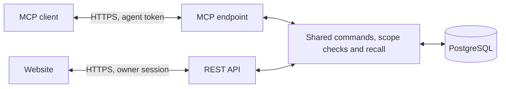

# MCP

Agents use Space through one MCP endpoint, served over streamable HTTP at the installation's public address plus `/mcp/`. The endpoint is stateless and answers in JSON. [Connecting agents](CONNECTING_AGENTS.md) shows how to set up common clients; this page describes access, the tools and the guidance Space serves to agents.

## Access

In key mode every MCP request carries a Space-issued token: an agent token (`Authorization: Bearer spc_...`) created on the website or through a device code, or an OAuth access token (`spo_...`) held by an app that signed in through the browser. Each token stands for one connection grant, bound to this MCP address and either read-only or read-write. Every content command checks the live grant, so revoking a connection on the website denies its next request, and a read-only grant rejects every write. The access key and personal API keys are refused on MCP. In private mode requests carry no token, and each agent identity gets its own connection; see [Architecture](ARCHITECTURE.md#identity-and-access).

Apps that sign in through the browser use OAuth 2.1. A request without a token is answered `401` with a `WWW-Authenticate` header naming the protected-resource metadata (RFC 9728) at `/.well-known/oauth-protected-resource/mcp`, which names the authorization server: the same origin as the MCP endpoint. Its metadata at `/.well-known/oauth-authorization-server` lists the endpoints under `/oauth/`: open client registration (RFC 7591), authorization with PKCE (S256 only), the token endpoint and revocation (RFC 7009). Authorization sends the owner to the website's `/connect/authorize` page, behind the access key; approving creates a connection grant for the registered client, like any other. Access tokens (`spo_`) last one hour. Refresh tokens (`spr_`) rotate on every use and expire after 180 days unused. Codes last ten minutes and work once; a code presented twice revokes the tokens it produced. Every secret is stored as a SHA-256 digest, and every token stops working when its connection is revoked. Private mode serves none of these endpoints, since it needs no token.

The owner creates a connection on the website under **Agents**. An agent that cannot receive a pasted token can ask for one with a six-digit code instead:

1. The agent calls `POST /v1/device/code` without credentials, optionally with `{"client_name": "...", "harness": "..."}`. It receives a `user_code`, a `device_code`, the `verification_url` (the website's `/connect` page) and `verification_url_complete`, the polling `interval` (5 seconds) and `expires_in` (10 minutes).
2. The owner enters the code on `/connect` and chooses the agent identity, the Space and whether the agent may write.
3. The agent polls `POST /v1/device/token` with its `device_code` every `interval` seconds. Until the owner answers it receives `authorization_pending`, `slow_down` if it polls too fast, then `access_denied` or `expired_token`. On approval it receives, once, the `access_token`, the `agent_id`, the `mcp_url` and ready-made `headers`.

The token lasts 180 days, is stored only as a SHA-256 digest and is listed and revoked on the Agents page like any other connection. Ten wrong codes within fifteen minutes block further codes until that window has passed.

Every content request also names the agent identity in the `X-Space-Agent-ID` header or the `agent_id` tool argument; [Agent identities](AGENT_IDENTITIES.md) gives the rules. Requests must use a host name listed in `SPACE_ALLOWED_HOSTS`, and a request body is limited to 1.5 MB.

## Tools

| Area | Tools |
|---|---|
| Discovery | `server_info`, `workspace_info`, `identify_agent`, `list_agent_identities`, `get_space_map` |
| Documents and tasks | `list_resources`, `get_resource`, `save_resource`, `task_columns`, `add_task_column`, `set_task_status`, `delete_task` |
| Agent inbox | `pull_events`, `ack_events` |
| Projects, folders, sections, categories and databases | `list_workspace_items`, `get_workspace_item`, `save_workspace_item`, `set_workspace_item_deleted`, `query_database` |
| Search and recall | `search_workspace`, `get_context` |
| Memory | `memory_info`, `list_memories`, `remember`, `remember_claims`, `extract_memory`, `memory_job`, `build_memory`, `change_memory`, `delete_memory`, `save_handoff`, `set_memory_links`, `get_memory_links` |

The tool schemas served by the endpoint are authoritative for arguments and types. Tools that can send content to a model provider are marked as open-world.

`save_resource` accepts a `change` object with `command_id`, `expected_revision`, `kind`, `title`, `body`, an optional task `status`, and `resource_id` for updates. New resources use revision zero. Read results include the resource ID, revision, timestamp and human or agent attribution, and historical revisions can be read explicitly. Documents and tasks are the same records the website and the REST API use. `save_resource` also accepts `recall` metadata for ordinary sources and handoffs (category, topics, source references, exclusion); leaving it out preserves it during edits. Generated memory documents use the dedicated memory tools.

`pull_events(space_id, request)` and `ack_events(space_id, request)` drain the Space's agent inbox: database change events queued by an inbox subscription that the owner created under Settings → Webhooks. A pull leases up to 50 waiting events for ten minutes and returns the same payload a webhook receiver would get; an acknowledgement marks them delivered. Both need a write grant. Nothing pushes to the agent, so an agent polls on a schedule or a loop. See [database webhooks](WEBHOOKS.md#agent-inbox-delivery).

`delete_task(space_id, resource_id, expected_revision)` permanently removes one task with every revision. It needs a write grant and an identified agent, rejects a stale revision and treats an absent task as a success. Separately saved memories remain. Agents cannot delete documents: the owner removes them on the website or through the REST API.

`delete_memory(space_id, resource_id, expected_revision)` removes one generated memory record with all of its claims, its revisions, its index rows and its command history. It follows the write grant; an absent record is a success. Use it when a memory should be gone rather than corrected, and `change_memory` with `action="forget"` when a single claim should go and the rest should stay.

Use `remember(space_id, change)` for authored text: classification when configured, embedding and immediate storage, with no text extraction and no queued job. `remember_claims(space_id, change)` stores finished, already separated claims through the same path. Use `extract_memory(space_id, change)` to mine text or a source revision into generated claims: it saves the input and returns a durable job ID, and `memory_job(space_id, job_id)` tells saved input apart from memory ready for recall. Extraction continues after the agent disconnects and stops if its connection is revoked. `build_memory` remains a synchronous extraction interface. `list_memories` takes `query`, `after` and `limit`; a query covers the whole Space and has no cursor, while browsing returns a newest-first cursor. [Memory](MEMORY.md) describes every write path.

`get_context` is recall. Use `request.mode="resume"` for "where were we?", or `mode="search"` with a query and a `strategy` of `auto`, `lexical`, `semantic` or `prompt`. The maximum `max_chars` is 20,000. Results keep source IDs and revisions, a `verification` value of `memory`, `handoff` or `user_authored`, and a `stale` flag. A recall that matched nothing carries `found: false` and a `note` telling the caller that memory holds nothing on the topic and that it must not invent content. `memory_info` shows the configured provider and models. Builds, memory writes and semantic or prompted recall can send permitted text to that provider; connecting an agent never imports chat history. Memory is autonomous: there is no review command, and a stored claim is live at once. Every command rechecks live access and source eligibility.

Projects are workspace items with their own tools: `list_workspace_items`, `get_workspace_item`, `save_workspace_item` and `set_workspace_item_deleted`. Database listings return the schema and `record_count` without records, and `query_database` reads and changes records with SQL on one table; see [SQL access to database records](DATABASE_SQL.md). A task or document can reference a project through the `project` field of `save_resource`, `search_workspace` can filter documents and tasks by project, and memory classification can scope a claim to projects. `save_resource` rejects a project that does not exist in the Space, and `search_workspace` returns an empty page for one. `get_space_map` returns the Space's containers and routing rules; see [Space map](SPACE_MAP.md).

## Served guidance

Space serves its own operating guidance rather than relying on documentation the owner must configure. The MCP instruction string carries the core rules; the `memory_guide` prompt and the `space://memory/guide` resource carry the fuller guide. Both are generated from the running configuration, so they name the provider, models and limits actually in effect and cannot describe a model that is not configured. Because memory is autonomous, this guidance replaces a review step: a claim an agent writes is live for every authorized agent at once, and the owner or a writer with a write grant can delete it.

## Agent skills

The optional skill pack in [`skills/`](../skills/README.md) adds reusable workflows around the same tools. Install only the folders you need:

| Skill | Use it when |
|---|---|
| [`space-session`](../skills/space-session/SKILL.md) | Start, resume, checkpoint or finish a session with project context and an accurate handoff |
| [`space-refine`](../skills/space-refine/SKILL.md) | Distill a conversation into a sourced session summary and selected reusable claims, with duplicate and correction checks |
| [`space-remember`](../skills/space-remember/SKILL.md) | Preserve reusable facts and lessons, with reasons, evidence, applicability and corrections |
| [`space-recall`](../skills/space-recall/SKILL.md) | The user asks about earlier work, or you need context you do not have |
| [`space-writeup`](../skills/space-writeup/SKILL.md) | Prepare a sourced document and apply the configured extraction policy |
| [`space-brief`](../skills/space-brief/SKILL.md) | Brief a project from its current goals, decisions, tasks and blockers |
| [`space-morning`](../skills/space-morning/SKILL.md) | Start the day: what changed, which task rows are planned for today, and a proposed short list |
| [`space-tasks`](../skills/space-tasks/SKILL.md) | Capture, find or update a task while retaining the original purpose and completion criteria |
| [`space-journal`](../skills/space-journal/SKILL.md) | Record a day or recap a specified day's available evidence |
| [`space-weekly-review`](../skills/space-weekly-review/SKILL.md) | Review a week's outcomes, carryover, decisions and lessons |
| [`space-init`](../skills/space-init/SKILL.md) | Set up a new Space: a short interview, proposed categories and projects, and the durable facts the user confirms |
| [`space-import`](../skills/space-import/SKILL.md) | Preview selected existing notes as sources and durable claims, check duplicates, and write only the approved bounded batch |
| [`space-audit`](../skills/space-audit/SKILL.md) | Inspect a Space for drift and propose repairs, acting only on the actions the user approves |
| [`space-find`](../skills/space-find/SKILL.md) | Locate a document, task, memory claim, project, database row, category or section, and page through a whole-Space scan |
| [`space-projects`](../skills/space-projects/SKILL.md) | Create, update, archive or restore a project, and attach tasks and documents to it |
| [`space-base`](../skills/space-base/SKILL.md) | Maintain a custom database: typed fields, records, table or board view and grouping |
| [`space-organize`](../skills/space-organize/SKILL.md) | Create categories and sections, and assign projects, categories and sections to stored claims |

Briefs and recaps are read-only unless saving is requested or covered by an established instruction. Journals and saved reviews are ordinary versioned documents, with explicit dates and source references. Installing skills does not schedule capture, import conversations or send handoffs to other agents. The pack's [verification scenarios](../skills/README.md#verification) distinguish schema checks from a live client trial.

The split is deliberate: the served guide carries the policy of one installation, and the skills carry workflow. The skills carry no installation-specific limits or model names; they describe tool defaults, ranges and list bounds in prose and example calls. Check the connected server's tool schema for those fields, and the served guide for provider policy and configured limits.

## How MCP and the website share work

MCP and the website use the same commands, revision checks and live grants. An agent may read, create and update sources and tasks, and write memory, only within its connection's permission. Sharing and administration are not available to agents.

MCP tool calls carry arguments to the server and results back to the client. Space receives readable content on writes and stores it as readable JSON; TLS protects it in transit, and the server's own protection is the operator's responsibility. [Data and privacy](PRIVACY.md) lists what is stored and what reaches a model provider. [MCP tools](https://modelcontextprotocol.io/specification/2025-11-25/server/tools), [MCP transports](https://modelcontextprotocol.io/specification/2025-11-25/basic/transports)

## Website assistant

A lightweight website assistant for owners who do not connect an external agent is a proposal, not a feature. It would start as a bounded retrieval and answer flow: the owner asks about the selected Space, retrieval resolves currently permitted sources, the configured model receives only that context, and the answer cites inspectable evidence. It would have no write, deletion or sharing capability, even though the owner can do those things manually, and would reuse the recall service rather than call the public MCP endpoint internally.
